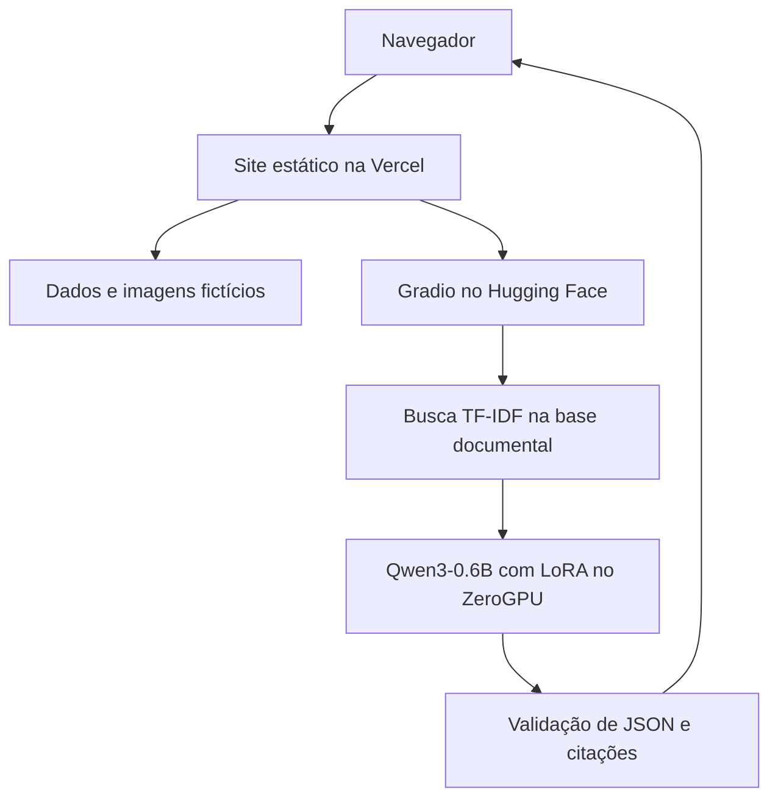

# Reencontro — FIAP CitizenTech

Protótipo acadêmico de apoio à consulta de casos fictícios de desaparecimento e ao encaminhamento de informações para revisão humana. Integra interface web, busca por informações, comparação visual demonstrativa, indicadores e um assistente com recuperação documental e modelo de linguagem adaptado por LoRA.

## Acessar

- **Site:** https://reencontro-site.vercel.app/
- **Assistente:** https://huggingface.co/spaces/MariAstro4/reencontro-assistente
- **Código:** https://github.com/MariMelo99/reencontro-site

O site e o assistente estão hospedados externamente e não dependem do computador dos integrantes. A geração por IA depende da disponibilidade e da cota gratuita do Hugging Face ZeroGPU; o acesso público não garante inferência ilimitada.

## Integrantes

| Nome | RM |
|---|---|
| Irana Pereira | RM98593 |
| Lucas Vinicius Candido | RM98480 |
| Mariana Melo | RM98121 |

**Turma:** 4ESPV · **Desafio:** CitizenTech

## Funcionalidades

- Consulta por nome e características, com filtros de ano, zona, idade, altura e sexo.
- Carrossel de casos e fichas com retratos sintéticos de duas épocas.
- Busca por foto com comparação visual demonstrativa, sujeita à revisão humana.
- Envio simulado de informações adicionais e fila de revisão.
- Indicadores da base fictícia e dos protocolos armazenados no navegador.
- Assistente com recuperação de trechos, resposta estruturada e apresentação de evidências.

A base de casos foi concebida com 100 registros fictícios. As imagens são sintéticas. A comparação visual não confirma identidade; a interface não é um sistema oficial de investigação ou atendimento de emergência.

## Arquitetura



O navegador utiliza o cliente JavaScript do Gradio e o endpoint `/consultar`. O assistente recupera até três trechos por TF-IDF e similaridade de cosseno, usando limiar de 0,20. O modelo base é `Qwen/Qwen3-0.6B`, com adaptador `lora_experimento_03` (LoRA de rank 8 nos módulos `q_proj` e `v_proj`).

O validador verifica campos e tipos do JSON, o identificador da fonte e a presença literal das citações nos trechos recuperados. Uma saída fora do formato é bloqueada. A aprovação formal **não garante** correção semântica, pertinência, preservação das negações ou veracidade de uma recusa.

## Organização

| Caminho | Conteúdo |
|---|---|
| `index.html`, `styles.css` | Interface e apresentação |
| `app.js` | Carrossel, filtros, fichas, fila e indicadores |
| `foto.js`, `foto-ui.js` | Comparação visual e interface de busca por foto |
| `data/` | Base dos casos fictícios |
| `SIM-*.jpg` | Imagens na raiz, conforme os caminhos ajustados em `data/casos.js` |
| `entrega-academica/projeto/` | Código do assistente, base documental e adaptador LoRA |
| `entrega-academica/RELATORIO_TECNICO_ATUALIZADO.md` | Arquitetura, evidências observadas e limites da avaliação |
| `entrega-academica/testes_observados.json` | Registro dos testes manuais, sem estimar métricas |
| `entrega-academica/CONFERENCIA_FINAL.json` | Escopo e resultados da conferência |

## Executar o site localmente

Requer Python 3 instalado. Na raiz do repositório:

```bash
python -m http.server 5500
```

Abra `http://localhost:5500`. O assistente continuará consultando o Space público; não é necessário iniciar uma API local para usar o HTML publicado.

## Executar e reproduzir o assistente

**Projeto local original:** [instruções completas](entrega-academica/projeto/README.md). Esse README descreve a execução local original, com API e site em localhost. Não é necessário manter o computador ligado para usar o site público atual.

**Versão hospedada:** [diferenças do Space](entrega-academica/versao-hospedada/LEIA-ME.md). O Space usa Gradio/ZeroGPU, Qwen3-0.6B e o adaptador do experimento 03. A pasta original preserva api.py (FastAPI local); app.py na pasta versao-hospedada registra a implementação pública.

Para reexecutar apenas as análises, abra Jupyter a partir de `entrega-academica/projeto` e acesse `notebooks/`. As células fornecidas reanalisam logs e resultados; não refazem treinamento ou inferência. Consulte o README interno para o ambiente.

O treino JSON é implementado em `treinar_json.py`. A avaliação de 12 perguntas é implementada por `avaliar_json_03.py`, que configura `avaliacao_final.py`. Antes de novo treino, escolha outra pasta SAIDA: os adaptadores e resultados originais devem ser preservados. O modelo base precisa estar previamente baixado porque os scripts locais usam local_files_only=True.

Os requirements locais originais foram preservados; os da versão hospedada são separados. Os arquivos de ambiente não garantem reprodução bit a bit sem uma revisão fixa do modelo e bibliotecas compatíveis.

## Testes e limitações conhecidas

Foram observadas respostas com evidências e validação formal aprovada sobre a finalidade do Reencontro. Também ocorreu recusa indevida para uma pergunta cuja resposta existe na base. A pergunta com interrogação apresentou inicialmente resultado diferente da versão sem interrogação; após normalização da pontuação final, houve um teste direto bem-sucedido. Isso não demonstra estabilidade em todas as formulações ou execuções.

A cota do ZeroGPU foi atingida durante testes. O serviço aplica limites de uso e filas; a cota diária é renovável. Não há garantia de disponibilidade contínua. Nenhum token pessoal deve ser inserido no HTML ou no repositório público.

### Avaliação experimental registrada

Os três notebooks, com saídas originais, estão em `entrega-academica/projeto/notebooks/`. Suas células de análise foram reexecutadas com os JSONs fornecidos; isso não refez treinamento nem inferência. O escopo está em `entrega-academica/CONFERENCIA_FINAL.json`.

| Configuração | JSON válido | Conteúdo correto e completo | Validação formal | Aproveitáveis: conteúdo correto + validação | Tempo médio local |
|---|---:|---:|---:|---:|---:|
| Sem contexto | 12/12 | 5/12 | 0/12 | 0/12 | 8,70 s |
| RAG simples | 12/12 | 9/12 | 3/12 | 3/12 | 9,45 s |
| LoRA + RAG | 12/12 | 10/12 | 11/12 | 9/12 | 9,71 s |

São 12 perguntas por configuração, com revisão assistida por IA sujeita à conferência da autora. Não são resultados de teste independente amplo. Os tempos foram registrados na execução local original, não na Vercel ou no ZeroGPU. Recall@1 e Recall@3 da recuperação: 5/6 = 83,33% nas perguntas respondíveis.

Os arquivos `avaliacao/avaliacao_congelada_20261114_160302_507373.json` e `avaliacao/revisao_assistida_experimento_03.json` preservam respostas e classificações; as perguntas e gabaritos também estão no script `avaliar_json_03.py`.

O notebook 03 mostra fabricação de informação no baseline e conteúdo adicional sem suporte no LoRA + RAG, inclusive um caso aceito pelo validador formal. Consulte o relatório técnico para os exemplos e limites. Os notebooks analisam logs e avaliações; não executam treinamento ou uma nova geração. A pasta completa inclui os scripts de treinamento, calibração e avaliação, os datasets, os logs e os adaptadores. As 12 perguntas do avaliador foram conferidas contra o registro congelado. O relatório Word original está em `entrega-academica/projeto/docs/Relatorio_Reencontro_LLM_Consolidado.docx`; ele foi preservado e deve ser lido junto das notas atualizadas sobre hospedagem.

## Dados e privacidade

Use apenas dados fictícios na demonstração. As consultas ao assistente são enviadas ao serviço Hugging Face. Os protocolos da interface ficam no armazenamento local do navegador; não representam um cadastro compartilhado ou atendimento real. Os trechos de orientação oficial devem ser conferidos nas fontes originais antes de uso fora do contexto acadêmico.

## Referências técnicas

- Qwen3-0.6B: https://huggingface.co/Qwen/Qwen3-0.6B
- ZeroGPU, cotas e requisitos: https://huggingface.co/docs/hub/spaces-zerogpu
- PEFT: https://huggingface.co/docs/peft/
- Cliente JavaScript Gradio: https://www.gradio.app/guides/getting-started-with-the-js-client
- Fontes documentais específicas: `entrega-academica/projeto/base/conhecimento.json`.
