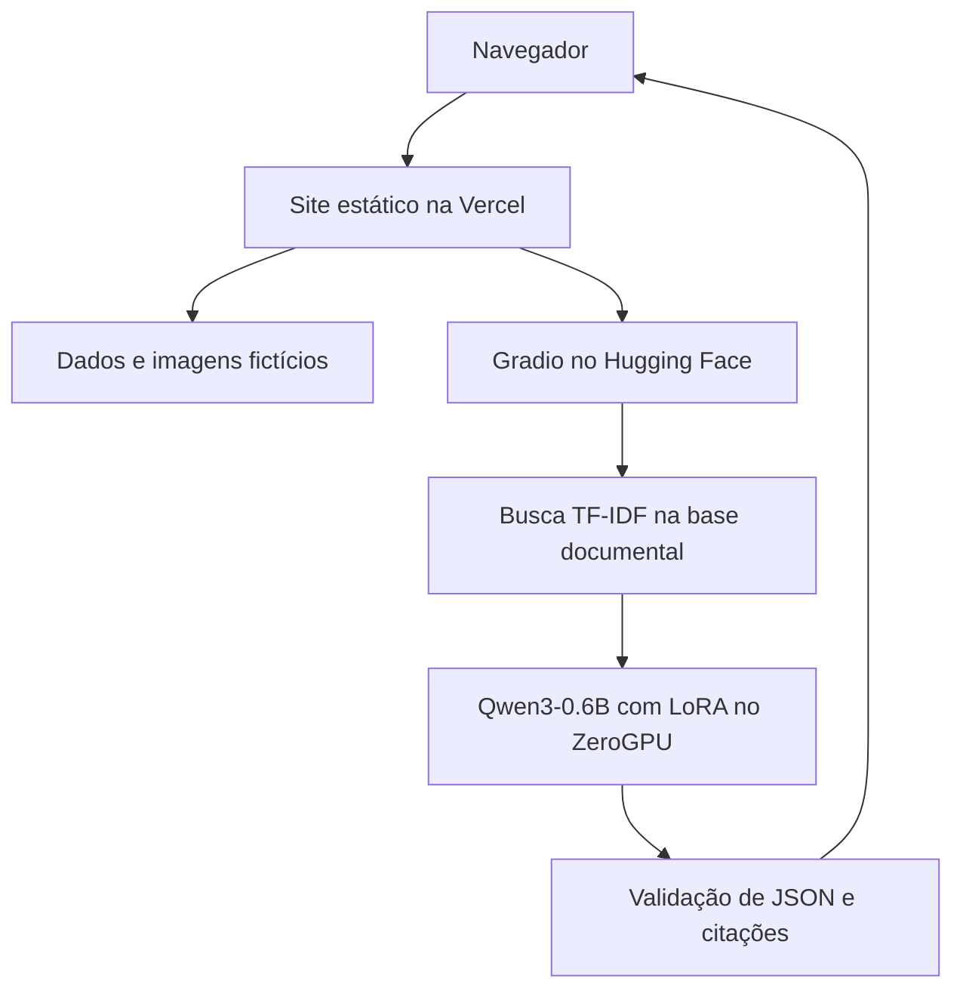

# Reencontro — FIAP CitizenTech

Protótipo acadêmico de apoio à consulta de casos fictícios de desaparecimento e ao encaminhamento de informações para revisão humana. Integra interface web, busca por informações, comparação visual demonstrativa, indicadores e um assistente com recuperação documental e modelo de linguagem adaptado por LoRA.

## Acessar

- **Site:** https://reencontro-site.vercel.app/
- **Assistente:** https://huggingface.co/spaces/MariAstro4/reencontro-assistente
- **Código:** https://github.com/MariMelo99/reencontro-site

O site e o assistente estão hospedados externamente e não dependem do computador dos integrantes. A geração por IA depende da disponibilidade e da cota gratuita do Hugging Face ZeroGPU; o acesso público não garante inferência ilimitada.

## Integrantes

| Nome | RM |
|---|---|
| Irana Pereira | RM98593 |
| Lucas Vinicius Candido | RM98480 |
| Mariana Melo | RM98121 |

**Turma:** 4ESPV · **Desafio:** CitizenTech

## Funcionalidades

- Consulta por nome e características, com filtros de ano, zona, idade, altura e sexo.
- Carrossel de casos e fichas com retratos sintéticos de duas épocas.
- Busca por foto com comparação visual demonstrativa, sujeita à revisão humana.
- Envio simulado de informações adicionais e fila de revisão.
- Indicadores da base fictícia e dos protocolos armazenados no navegador.
- Assistente com recuperação de trechos, resposta estruturada e apresentação de evidências.

A base de casos foi concebida com 100 registros fictícios. As imagens são sintéticas. A comparação visual não confirma identidade; a interface não é um sistema oficial de investigação ou atendimento de emergência.

## Arquitetura



O navegador utiliza o cliente JavaScript do Gradio e o endpoint `/consultar`. O assistente recupera até três trechos por TF-IDF e similaridade de cosseno, usando limiar de 0,20. O modelo base é `Qwen/Qwen3-0.6B`, com adaptador `lora_experimento_03` (LoRA de rank 8 nos módulos `q_proj` e `v_proj`).

O validador verifica campos e tipos do JSON, o identificador da fonte e a presença literal das citações nos trechos recuperados. Uma saída fora do formato é bloqueada. A aprovação formal **não garante** correção semântica, pertinência, preservação das negações ou veracidade de uma recusa.

## Organização

| Caminho | Conteúdo |
|---|---|
| `index.html`, `styles.css` | Interface e apresentação |
| `app.js` | Carrossel, filtros, fichas, fila e indicadores |
| `foto.js`, `foto-ui.js` | Comparação visual e interface de busca por foto |
| `data/` | Base dos casos fictícios |
| `SIM-*.jpg` | Imagens na raiz, conforme os caminhos ajustados em `data/casos.js` |
| `entrega-academica/assistente/` | Código do assistente, base documental e adaptador LoRA |
| `entrega-academica/RELATORIO_TECNICO.md` | Arquitetura, evidências observadas e limites da avaliação |
| `entrega-academica/testes_observados.json` | Registro dos testes manuais, sem estimar métricas |
| `entrega-academica/PENDENCIAS.md` | Materiais acadêmicos ainda a incorporar |

## Executar o site localmente

Requer Python 3 instalado. Na raiz do repositório:

```bash
python -m http.server 5500
```

Abra `http://localhost:5500`. O assistente continuará consultando o Space público; não é necessário iniciar uma API local para usar o HTML publicado.

## Executar o assistente

### Hugging Face ZeroGPU

No Space, mantenha SDK Gradio e hardware ZeroGPU. Envie **o conteúdo** de `entrega-academica/assistente/` para a raiz do Space, preservando `base/` e `artefatos/`. O README interno possui os metadados do Space. O modelo base é baixado durante a inicialização; os pesos do adaptador estão incluídos.

A dependência PyTorch e a versão do Gradio são gerenciadas pelo ambiente do Space. As demais dependências constam do `requirements.txt` interno. Uma instalação futura pode exigir ajustes de compatibilidade; as versões ainda não foram congeladas a partir do ambiente efetivamente implantado.

### Computador local

Em um ambiente Python compatível com PyTorch e Gradio:

```bash
cd entrega-academica/assistente
python -m venv .venv
# Ative o ambiente conforme seu sistema operacional.
python -m pip install torch gradio
python -m pip install -r requirements.txt
python app.py
```

O `app.py` está configurado para CUDA/ZeroGPU. Fora do Hugging Face, requer GPU CUDA compatível. Para CPU, adapte `model.to("cuda")` e a transferência das entradas para `"cpu"`; o desempenho será diferente.

`api_local.py` preserva a implementação FastAPI original e **não** representa o endpoint usado pelo site atual. Ela exige dependências adicionais (FastAPI e Uvicorn), modelo previamente baixado e configuração local de origens CORS. Não a publique sem adaptar essas configurações.

## Testes e limitações conhecidas

Foram observadas respostas com evidências e validação formal aprovada sobre a finalidade do Reencontro. Também ocorreu recusa indevida para uma pergunta cuja resposta existe na base. A pergunta com interrogação apresentou inicialmente resultado diferente da versão sem interrogação; após normalização da pontuação final, houve um teste direto bem-sucedido. Isso não demonstra estabilidade em todas as formulações ou execuções.

A cota do ZeroGPU foi atingida durante testes. O serviço aplica limites de uso e filas; a cota diária é renovável. Não há garantia de disponibilidade contínua. Nenhum token pessoal deve ser inserido no HTML ou no repositório público.

Não há, neste complemento, métricas agregadas de acurácia, latência, taxa de alucinação ou taxa de recusas: elas precisam ser calculadas com conjunto de teste definido e saídas preservadas. Consulte as pendências para os notebooks e as avaliações ainda necessárias.

## Dados e privacidade

Use apenas dados fictícios na demonstração. As consultas ao assistente são enviadas ao serviço Hugging Face. Os protocolos da interface ficam no armazenamento local do navegador; não representam um cadastro compartilhado ou atendimento real. Os trechos de orientação oficial devem ser conferidos nas fontes originais antes de uso fora do contexto acadêmico.

## Referências técnicas

- Qwen3-0.6B: https://huggingface.co/Qwen/Qwen3-0.6B
- ZeroGPU, cotas e requisitos: https://huggingface.co/docs/hub/spaces-zerogpu
- PEFT: https://huggingface.co/docs/peft/
- Cliente JavaScript Gradio: https://www.gradio.app/guides/getting-started-with-the-js-client
- Fontes documentais específicas: `entrega-academica/assistente/base/conhecimento.json`.
