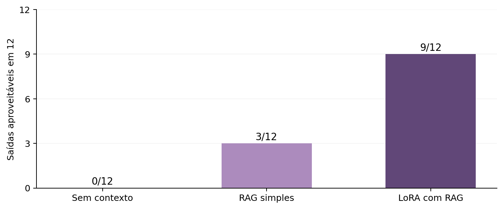
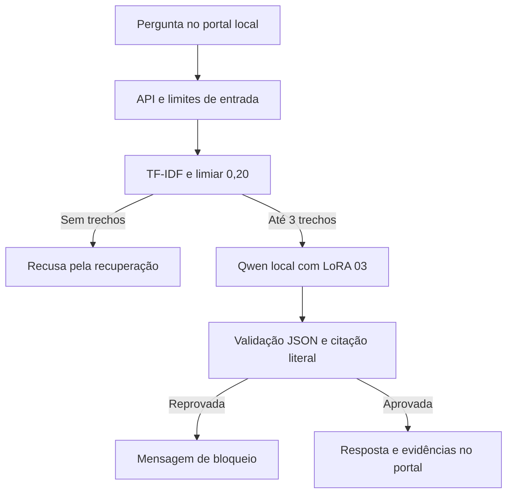

# Reencontro

Assistente local de orientação documental sobre desaparecimentos, integrado a um protótipo web acadêmico. Disciplina Generative AI for Engineering, FIAP. Professor Francisco Elanio Bezerra.

**Desafio FIAP CitizenTech • Turma 4ESPV**

| Integrante | RM |
| --- | --- |
| Irana Pereira | RM98593 |
| Lucas Vinicius Candido | RM98480 |
| Mariana Melo | RM98121 |

**Repositório público** — preencher a URL após a publicação.  
**Vídeo** — preencher a URL após a gravação.

O usuário faz uma pergunta, o sistema busca documentos e uma LLM local gera uma resposta estruturada. O portal apresenta resposta, fonte e citação, ou informa que a informação não está disponível. O assistente não confirma identidade, localização de pessoas nem realiza encaminhamentos reais.

## Resultado principal

O experimento 03 foi treinado em CPU com LoRA, 32 exemplos em JSON e 8 de validação. Na avaliação congelada de 12 perguntas reformuladas, houve 9 saídas completas e formalmente aprovadas com LoRA + RAG, 3 com RAG simples e 0 sem contexto. Pelo conteúdo isolado, ignorando erros formais, os totais foram 10, 9 e 5, respectivamente. Esses critérios não devem ser confundidos.

| Medida em 12 perguntas | Sem contexto | RAG simples | LoRA + RAG |
| --- | ---: | ---: | ---: |
| JSON sintaticamente válido | 12 | 12 | 12 |
| Validação formal aprovada | 0 | 3 | 11 |
| Conteúdo correto e completo | 5 | 9 | 10 |
| Conteúdo correto e validação aprovada | 0 | 3 | 9 |
| Conteúdo sem suporte na resposta | 4 | 1 | 1 |
| Fonte ou citação inválida | 7 | 2 | 1 |
| Tempo médio de geração | 8,70 s | 9,45 s | 9,71 s |



A contagem de conteúdo sem suporte inclui acréscimos factuais ou recomendações não sustentadas pela base. Não inclui placeholders como se fossem fatos inventados. Citações inválidas e erros de formato são categorias separadas e podem se sobrepor. A classificação por leitura é uma revisão assistida por IA, documentada por pergunta e sujeita à conferência da autora. Os 11 JSONs formalmente aprovados não equivalem a 11 respostas corretas.

A recuperação obteve recall@1 = recall@3 = 83,3%, em 6 perguntas respondíveis. Uma pergunta sobre a quantidade de casos ficou sem contexto. A abstenção foi adequada ao contexto vazio, mas representa falha do sistema porque a informação existe na base.

## Arquitetura



A explicação é a apresentação da fonte e do trecho de apoio. A validação não verifica integralmente o sentido ou a pertinência. A busca utiliza sete trechos de orientações e documentação, separados dos 100 casos fictícios do portal. O totem é um canal previsto, sem equipamento físico demonstrado nesta entrega.

## Estrutura

- `notebooks/` — três notebooks com análises executadas dos dados e logs reais.
- `base/` — trechos consultáveis e metadados das fontes.
- `dados/` — dados sintéticos dos primeiros experimentos.
- `artefatos/` — adaptadores, dados do treino 03 e logs de treinamento.
- `avaliacao/` — saídas congeladas originais, calibração, revisão assistida e placar CSV.
- `docs/` — relatório, arquitetura, evidências recebidas, privacidade e alterações da organização.
- `integracao_site/` — HTML para substituir no site existente, com instruções.
- `api.py`, `busca.py`, `assistente_validado.py` — API, recuperação e validador.

## Ambiente original

Windows, Ryzen 7 5700G, 8 núcleos e 16 processadores lógicos, 31,4 GB de RAM utilizável. CPU em float32, 8 threads. Python 3.12, PyTorch 2.15.0+cpu, Transformers 5.23.0 e PEFT 0.21.3 conforme o ambiente e os logs fornecidos.

As versões foram preservadas no requirements. A instalação completa em uma segunda máquina não foi demonstrada. Se uma versão não estiver disponível no índice, registre o erro e crie outro ambiente documentado em vez de alegar reprodução exata. O commit original do modelo base não foi fixado, limitando a reprodução byte a byte.

## Instalação no Windows

Abra o PowerShell na pasta extraída deste projeto. Não mescle diretamente o pacote organizado com outro diretório sem guardar uma cópia anterior.

```powershell
py -3.12 -m venv .venv
.\.venv\Scripts\python.exe -m pip install --upgrade pip
.\.venv\Scripts\python.exe -m pip install -r requirements.txt
.\.venv\Scripts\python.exe baixar_modelo.py
```

O download inicial do modelo precisa de internet e ocupa cerca de 1,5 GB para os pesos, além dos arquivos auxiliares. Os scripts de inferência usam `local_files_only=True`. O modelo base não foi incluído no ZIP. O adaptador 03 foi incluído. Não é necessário treinar novamente para executar a demonstração.

```powershell
.\.venv\Scripts\python.exe verificar_entrega.py
.\.venv\Scripts\python.exe -m uvicorn api:app --host 127.0.0.1 --port 8000
```

Aguarde `Application startup complete`. Abra http://127.0.0.1:8000/saude e confirme o adaptador `lora_experimento_03`. O terminal deve permanecer aberto. A documentação de testes fica em http://127.0.0.1:8000/docs.

## Abrir o portal

O ZIP recebido para organização contém a LLM, sem a pasta completa do site. O complemento HTML está em `integracao_site/index.html`. Copie-o para a pasta original que já contém `styles.css`, `app.js`, `foto.js`, `foto-ui.js`, `data/casos.js` e `assets/`. Para publicar todo o produto, acrescente também esses arquivos ao repositório.

Em outro PowerShell, aberto na pasta completa do site, execute:

```powershell
py -3.12 -m http.server 5500 --bind 127.0.0.1
```

Abra http://127.0.0.1:5500. Faça o teste de orientação sobre o SINAL e de ausência de telefone. Mantenha os dois terminais abertos. A porta 5500 serve o site e a porta 8000 executa a API.

## Reproduzir o treinamento e a avaliação

Os arquivos originais permanecem disponíveis. Para treinar novamente, altere a variável `SAIDA` de `treinar_json.py` para uma nova pasta, pois o script protege o experimento existente.

```powershell
.\.venv\Scripts\python.exe treinar_json.py
```

O treino 03 começa no modelo original e cria um adaptador novo. Configuração LoRA `r=8`, `alpha=16`, dropout `0,05`, módulos `q_proj` e `v_proj`, AdamW, taxa `0,0001`, 3 épocas e semente 42. Somente os tokens da resposta JSON entram na perda. A época 2 foi selecionada por menor perda de validação, 0,009320. O log registrou 453,3 segundos, cerca de 7,6 minutos.

A avaliação pode ser repetida com o adaptador 03 incluído:

```powershell
.\.venv\Scripts\python.exe avaliar_json_03.py
```

Ela gera 36 saídas e grava outro JSON com data e hashes. O contexto e a instrução são iguais entre B e C. Em A, os documentos ficam vazios, mas a instrução documental é mantida. Essa configuração influencia o comportamento de recusa e limita a interpretação como baseline geral de conhecimento.

Os conjuntos anteriores já analisados são de desenvolvimento. As perguntas mais recentes são novas formulações de fatos presentes na base e, no treino 03, também ensinados no ajuste. Não constituem teste de generalização a fatos ou documentos inéditos.

O avaliador chama a geração mesmo com busca vazia para medir o comportamento do modelo. A API, em contraste, encerra com recusa antes da geração nesse caso. Portanto, as latências e os erros do avaliador não são uma medição idêntica do endpoint de produção.

## Notebooks com saídas

Os notebooks executam auditoria e análise dos arquivos reais recebidos. Eles não simulam execuções de treinamento nem incluem números inventados. As saídas de treinamento e inferência são lidas dos logs originais e explicitamente identificadas como evidências externas produzidas no computador da autora.

Para abrir no VS Code, instale as extensões Python e Jupyter e selecione o ambiente do projeto. Se necessário:

```powershell
.\.venv\Scripts\python.exe -m pip install -r requirements_notebooks.txt
```

O notebook 01 verifica dados e repete a recuperação. O 02 analisa os três logs de treinamento. O 03 apresenta as saídas congeladas e o placar revisado. A reexecução integral do modelo ocorre pelos scripts documentados acima. Caso a banca exija o treino dentro do notebook, execute `treinar_json.py` em uma célula de um ambiente local, com uma nova pasta de saída e preservando a execução original.

## Limiar e recall

A calibração compara limiares de 0,00 a 1,00 em incrementos de 0,02 sobre 14 perguntas, metade respondível. O critério é maior acurácia balanceada, com desempate por maior sensibilidade e menor limiar. Foi escolhido 0,20. No conjunto de calibração, 7/7 perguntas respondíveis foram aceitas e 7/7 sem resposta foram rejeitadas.

O recall é calculado apenas nas perguntas com fontes esperadas. Recall@k é a fração das fontes relevantes presentes entre os primeiros k trechos recuperados. A média é feita por pergunta respondível. Nos dois testes congelados, os valores foram 66,7%/83,3% e 83,3%/83,3%, respectivamente. A diferença entre a calibração perfeita e o teste evidencia limitação de generalização lexical.

## Cinco erros e evolução

1. Recusa indevida com informação sobre espera de 24 horas disponível no contexto. Foram acrescentados exemplos de negação e respostas documentais.
2. Inversão de “não dispensa” para “dispensa”. O treino 03 incluiu o domínio, sem comprovar eliminação geral de contradições.
3. Cópia do placeholder “Resposta fundamentada nos documentos.”. O validador bloqueia essa saída e o treino JSON reduziu sua ocorrência no último conjunto.
4. Recusa na pergunta de quantidade porque o TF-IDF não recuperou o trecho. Uma próxima versão pode avaliar recuperação semântica em conjunto separado, preservando estes resultados.
5. Citação correta no sentido, mas não literal, no envio de relato. O validador bloqueou a citação que omitiu “fila de”. Ajustar treino extrativo e medir em novas perguntas é uma proposta futura.

## Segurança e privacidade

Ver `docs/SEGURANCA_E_PRIVACIDADE.md`. O protótipo utiliza dados fictícios, orienta a não incluir dados pessoais e executa o modelo localmente. A API não grava o corpo das consultas em arquivo. Isso não equivale a conformidade integral à LGPD. A interface não realiza anonimização automática, e o endpoint não tem autenticação para operação pública. Não exponha esta demonstração local como serviço para dados reais sem novo projeto e avaliação dos controles.

## Fontes e licenças

A origem e as condições identificadas dos sete trechos estão em `base/fontes.json` e `base/FONTES.md`. O modelo base informa Apache 2.0. As licenças dos documentos e as do código autoral não são intercambiáveis. A licença do trabalho autoral deve ser escolhida pela autora. Não foi atribuída automaticamente uma licença ao projeto.

## Entregáveis no GitHub

O repositório público deve reunir os notebooks com saídas em `notebooks/`, a base em `base/`, os conjuntos de teste em `dados/` e nos arquivos de avaliação, a API em `api.py` e este README. O relatório está em [docs/Relatorio_Reencontro_LLM_Consolidado.docx](docs/Relatorio_Reencontro_LLM_Consolidado.docx) e apresenta código e execução, arquitetura, performance, exemplos de alucinação e limitações.

## Pendências antes de entregar

- Conferir e aprovar a revisão assistida por pergunta.
- Incluir os demais arquivos do site se o repositório representar o produto completo.
- Confirmar condições de redistribuição das fontes e a licença do trabalho autoral.
- Publicar no GitHub e preencher a URL, sem `.venv`, caches ou credenciais.
- Gravar o vídeo e preencher o link. Conferir o acesso em janela anônima.

A publicação no GitHub e o vídeo ainda não foram realizados nesta organização.
